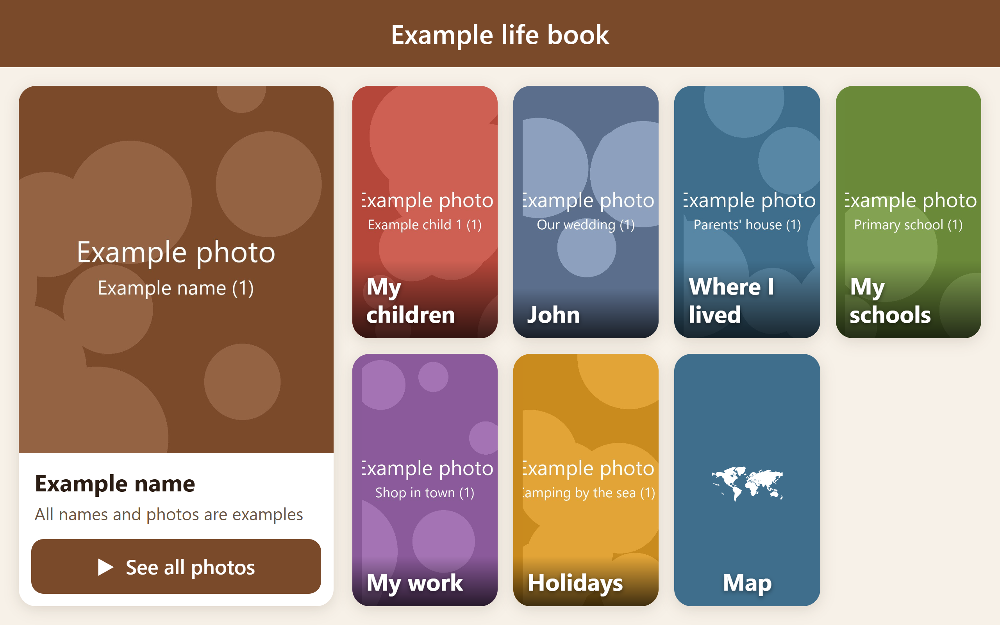
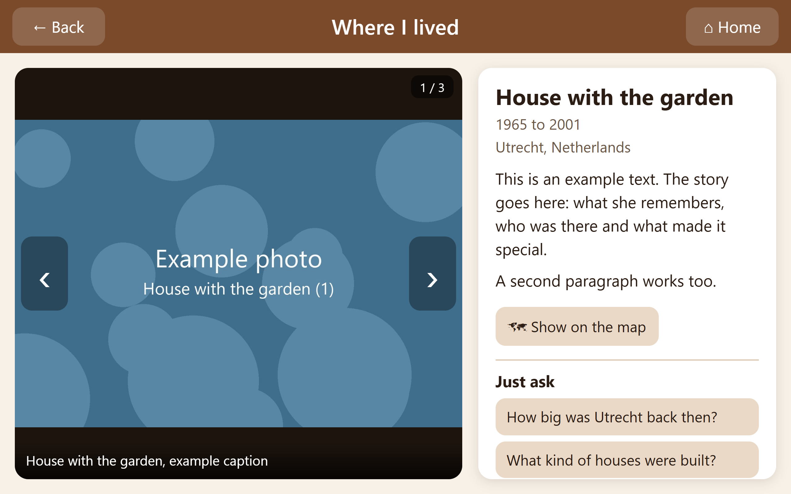

# Life Tiles

**English** | [Nederlands](#nederlands)

**A life story in big tiles: photos, places and memories on a tablet, offline and private.**

Life Tiles turns the photos and life story of a parent or grandparent into a calm app for their tablet: the children, the partner, the homes, schools, work, holidays and family. With large tiles, a map, an automatic slideshow and questions that are read aloud.

### Why I made it

For my mother's 89th birthday I built her a tablet app with her whole life in it: photos, the places she lived, her school, work, holidays and family. Big tiles, a map, a slideshow, and it reads answers aloud.

I've now made it free and open source, so you can make one for your own parents or grandparents. It works offline and the photos never leave the tablet.

Soon also in the Google Play Store. Want to be a tester? [Open an issue](https://github.com/HerberttenHave/life-tiles/issues) or send me a message.

Herbert ten Have

- **Offline and private.** Photos stay on the tablet. The app online is an empty shell; you load your own package into it.
- **Made for older people.** Large buttons, few choices, and the slideshow starts by itself when nobody touches the tablet.
- **No programming.** Make the book on the tablet itself, or for big books fill in an Excel file, put photos in folders and run one command.
- **Map** of all the places in their life, also offline.
- **Questions per chapter** with a checked answer that the tablet reads aloud. Optionally, ask your own question by voice.
- **English and Dutch**, chosen per book.

**Try it:** [lifetiles.web.app/?demo](https://lifetiles.web.app/?demo) (example photos only)

### Build your own

1. [Worksheet](docs/WORKSHEET.md): decide together what goes in.
2. [Guide](docs/GUIDE.md): from collecting photos to the app on the tablet.

### What is inside

| Folder | Contents |
|---|---|
| `app/` | The app (HTML, CSS, JavaScript; runs in Chrome and Safari, installable) |
| `tools/build_content.py` | Turns the Excel file and photo folders into the tablet package |
| `tools/make_demo.py` | Builds the English and Dutch demos with placeholder photos |
| `functions/` | Optional: function for spoken questions (Firebase and Gemini) |
| `docs/` | Worksheet and guide, in English and Dutch |
| `store/` | Store listing, images and Play Store checklist |

Free to use under the [MIT licence](LICENSE). [Privacy](https://lifetiles.web.app/privacy.html).

---

## Nederlands

**Een levensverhaal in grote tegels: foto's, plekken en herinneringen op een tablet, offline en privé.**

Life Tiles maakt van de foto's en het levensverhaal van een ouder of grootouder een rustige app voor de tablet: de kinderen, de partner, waar iemand woonde, naar school ging en werkte, de vakanties en de familie. Met grote tegels, een kaart, een automatische diashow en vragen die hardop worden voorgelezen.

### Waarom ik dit maakte

Voor de 89e verjaardag van mijn moeder heb ik een tablet-app voor haar gemaakt met haar hele leven erin: foto's, de plekken waar ze woonde, haar school, werk, vakanties en familie. Grote tegels, een kaart, een diashow, en de app leest antwoorden hardop voor.

Nu heb ik hem gratis en open source gemaakt, zodat jij er een kunt maken voor je eigen ouders of grootouders. Hij werkt zonder internet en de foto's verlaten de tablet nooit.

Binnenkort ook in de Google Play Store. Wil je testen? [Open een issue](https://github.com/HerberttenHave/life-tiles/issues) of stuur me een bericht.

Herbert ten Have

- **Offline en privé.** De foto's staan alleen op de tablet. De app op internet is een lege huls; je laadt je eigen pakket in.
- **Gemaakt voor ouderen.** Grote knoppen, weinig keuzes, de diashow start vanzelf als niemand de tablet aanraakt.
- **Zonder programmeren.** Maak het boek op de tablet zelf, of vul voor grote boeken een Excel-bestand in, zet foto's in mappen en draai één opdracht.
- **Kaart** met alle plekken uit het leven, ook zonder internet.
- **Vragen per hoofdstuk** met een nagezocht antwoord dat de tablet voorleest. Optioneel ook zelf een vraag inspreken.
- **Nederlands en Engels**, te kiezen per boek.

**Probeer het:** [lifetiles.web.app/?demo](https://lifetiles.web.app/?demo) (alleen voorbeeldfoto's)

### Zelf maken

1. [Werkblad](docs/WERKBLAD.md): bedenk samen wat erin moet.
2. [Stappenplan](docs/STAPPENPLAN.md): van foto's verzamelen tot de app op de tablet.

Vrij te gebruiken onder de [MIT-licentie](LICENSE).
