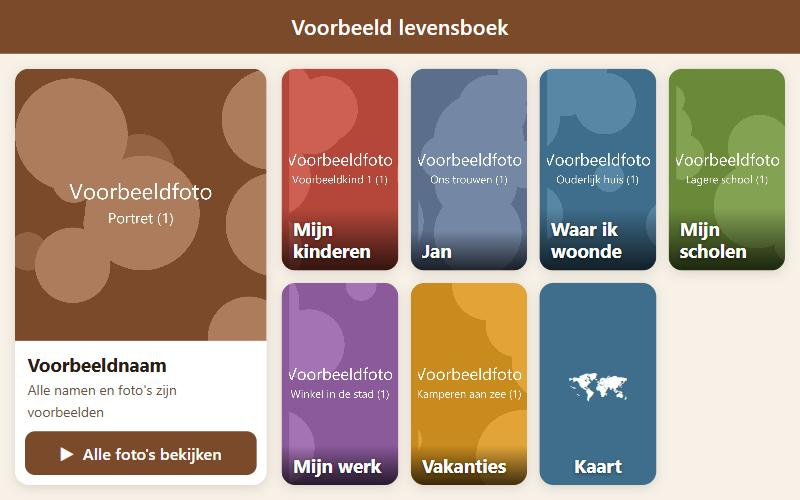
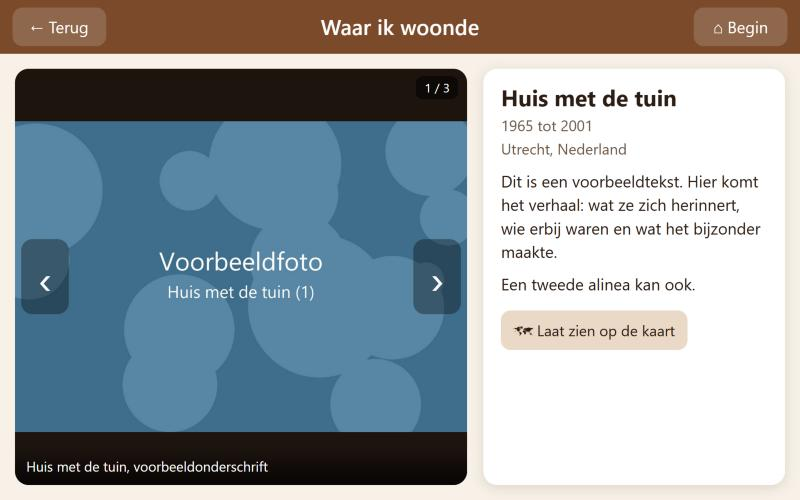
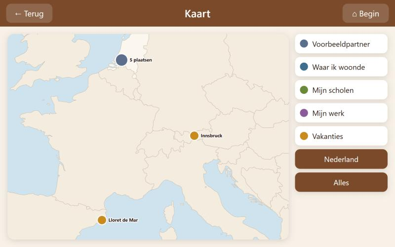

# Levensboek

**Nederlands** | [English](#english)

Een levensboek-app voor een tablet: de foto's en het levensverhaal van een ouder, grootouder of ander familielid. Waar iemand woonde, naar school ging en werkte, de vakanties, de kinderen en de familie. Met grote tegels, een kaart, een automatische diashow en vragen die hardop worden voorgelezen.

- **Offline en privé.** De foto's staan alleen op de tablet. De app op internet is een lege huls; je laadt je eigen pakket in.
- **Gemaakt voor ouderen.** Grote knoppen, weinig keuzes, de diashow start vanzelf als niemand de tablet aanraakt.
- **Zonder programmeren.** Je vult een Excel-bestand in, zet foto's in mappen en draait één opdracht.
- **Kaart** met alle plekken uit het leven, ook zonder internet.
- **Vragen per hoofdstuk** met een nagezocht antwoord dat de tablet voorleest. Optioneel ook zelf een vraag inspreken.

### Zelf maken

1. [Werkblad](docs/WERKBLAD.md): bedenk samen wat erin moet.
2. [Stappenplan](docs/STAPPENPLAN.md): van foto's verzamelen tot de app op de tablet.

Bekijk het voorbeeld met nepfoto's: **https://herberttenhave.github.io/levensboek/?voorbeeld**

### Wat zit erin

| Map | Inhoud |
|---|---|
| `app/` | De app (HTML, CSS, JavaScript, werkt in Chrome en Safari) |
| `tools/build_content.py` | Maakt van Excel en fotomappen het pakket voor de tablet |
| `tools/make_demo.py` | Maakt het voorbeeld met nepfoto's |
| `functions/` | Optioneel: functie voor zelf ingesproken vragen (Firebase en Gemini) |
| `docs/` | Werkblad en stappenplan, in het Nederlands en Engels |

Gemaakt door Herbert ten Have voor zijn moeder, die 89 werd. Vrij te gebruiken onder de [MIT-licentie](LICENSE).

---

## English

A life book app for a tablet: the photos and life story of a parent, grandparent or other family member. Where they lived, went to school and worked, their holidays, children and family. With large tiles, a map, an automatic slideshow and questions that are read aloud.

- **Offline and private.** Photos stay on the tablet. The app on the internet is an empty shell; you load your own package into it.
- **Made for older people.** Large buttons, few choices, and the slideshow starts by itself when nobody touches the tablet.
- **No programming.** Fill in an Excel file, put photos in folders and run one command.
- **Map** of all the places in their life, also offline.
- **Questions per chapter** with a checked answer that the tablet reads aloud. Optionally, ask your own question by voice.

The app's interface is in Dutch; your own titles and stories can be in any language.

### Build your own

1. [Worksheet](docs/WORKSHEET.md): decide together what goes in.
2. [Guide](docs/GUIDE.md): from collecting photos to the app on the tablet.

See the demo with placeholder photos: **https://herberttenhave.github.io/levensboek/?voorbeeld**

### What is inside

| Folder | Contents |
|---|---|
| `app/` | The app (HTML, CSS, JavaScript; runs in Chrome and Safari) |
| `tools/build_content.py` | Turns the Excel file and photo folders into the tablet package |
| `tools/make_demo.py` | Builds the demo with placeholder photos |
| `functions/` | Optional: function for spoken questions (Firebase and Gemini) |
| `docs/` | Worksheet and guide, in Dutch and English |

Made by Herbert ten Have for his mother when she turned 89. Free to use under the [MIT licence](LICENSE).
